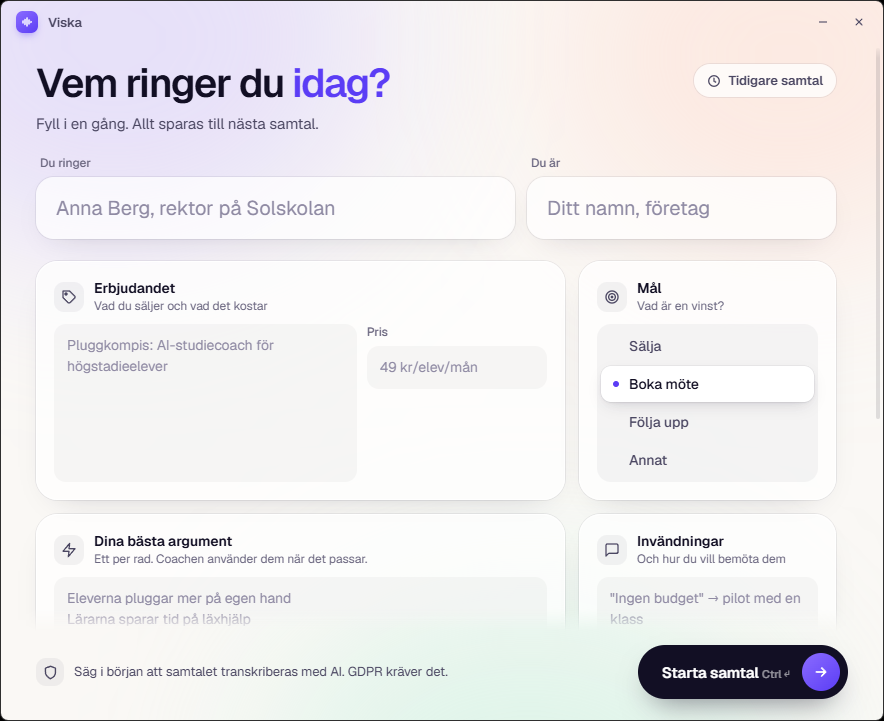

<p align="center">
  
</p>

<p align="center">
  <a href="https://github.com/welovevyxzl/viska/releases/latest/download/Viska.exe"><b>Download Viska.exe</b></a>
  &nbsp;·&nbsp;
  <a href="#how-it-works">How it works</a>
  &nbsp;·&nbsp;
  <a href="#build-from-source">Build from source</a>
</p>

Viska sits in a small window next to your call. The other person says "we have no budget for this", and a second or two later you see a line you can say back, plus two alternatives. It reads your own pitch (who you call, what you sell, price, arguments, objections) and will not invent prices or promises that are not in it.

It is built for calls in Swedish.

<p align="center">
  
  &nbsp;&nbsp;
  
</p>

## Install

1. Download [Viska.exe](https://github.com/welovevyxzl/viska/releases/latest/download/Viska.exe). There is no installer.
2. Run it and paste your OpenAI API key. It is saved on your PC only.
3. Fill in the form, choose a mode and press **Starta samtal**.

Windows SmartScreen will likely warn about an unknown publisher because the exe is not code-signed. Choose More info, then Run anyway.

You pay OpenAI for what you use. Tell the person you are calling that the call is transcribed with AI, since GDPR requires it.

## Modes

| | Computer | Phone on speaker |
|---|---|---|
| For | Calls on your PC: Teams, Meet, WhatsApp | A phone placed next to the PC |
| Their voice | Captured from the PC's audio output | Picked up by the microphone |
| Who is talking | Detected automatically | Hold the button (or Space) while they talk |

## How it works

<p align="center">
  
</p>

Each audio source gets its own connection to OpenAI's Realtime API. A simple voice detector tracks the background noise, so quiet calls still register, and a turn ends after about half a second of silence. Names and product words from your form go along as hints so they are spelled correctly, and text in other alphabets, which the transcriber sometimes produces by mistake, is thrown away.

## Build from source

Needs Windows and a recent Python 3. The release exe was built with 3.14.

```bash
python -m venv .venv
.venv\Scripts\python -m pip install -r requirements.txt
copy .env.example .env
```

Put your key in `.env` (git-ignored), then run:

```bash
.venv\Scripts\python samtalscoach.py
```

To build the exe:

```bash
.venv\Scripts\python -m PyInstaller --noconfirm --onefile --windowed --name Viska --add-data "ui;ui" samtalscoach.py
```

The result is `dist\Viska.exe`.

## Notes

- `samtalscoach.py` holds audio capture, transcription and the coach. `ui/index.html` is the whole interface, shown with pywebview (WebView2).
- The key is read from the `OPENAI_API_KEY` environment variable, then a `.env` file next to the exe, then the saved config.
- Your form and settings are in `%APPDATA%\Viska\config.json`. A debug log is in `%APPDATA%\Viska\viska.log`.
- If the mic will not open, it is probably muted (Fn key or Windows sound settings). Unmute, press Avsluta, then Starta.
- If you hear nothing from the other person in Computer mode, check that the call audio plays through the output device chosen in setup.
