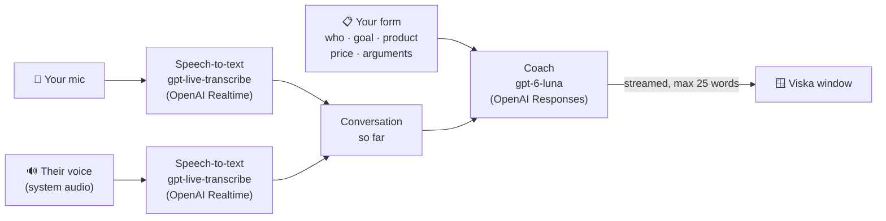

<div align="center">

# 🎧 Viska

### A real-time sales coach that whispers what to say next.

Viska listens to your sales call and shows the best next sentence on screen, within a second or two.
Built for Swedish-language calls.

[](https://github.com/welovevyxzl/viska/releases/latest/download/Viska.exe)
&nbsp;
[](https://github.com/welovevyxzl/viska/releases/latest)
&nbsp;


<br>


</div>

<br>

## ✨ What it does

You're on a call. The other person says *"We don't have the budget for this right now."*
One to two seconds later, Viska shows you exactly what to say, plus two backup lines:

> **Förstår helt. Om första månaden var gratis, hade ni testat med en klass?**
> 1. Vad gör ni idag när elever behöver läxhjälp?
> 2. Kan vi boka 15 minuter nästa vecka så visar jag?

No scripts to memorise, no tab-switching. A small always-on-top window sits next to your call.

| | |
|---|---|
| ⚡ **Fast** | Suggestions stream in as they are written. The app shows the time to first word on every suggestion. |
| 🧠 **Knows your pitch** | You fill in who you call, what you sell, price, arguments and objections once. Viska never invents facts or prices outside what you wrote. |
| 🎙️ **Hears both sides** | Your microphone and the other person's voice are transcribed separately, so it always knows who said what. |
| 📞 **Works with anything** | Teams, Meet, Zoom, WhatsApp, or a phone on speaker. |
| 📌 **Stays out of the way** | A compact, frameless window that stays on top. Pause it or ask for a new suggestion any time. |

<br>

## 🖼️ Screenshots

<div align="center">


<sub>**Setup:** fill it in once, it is saved for next time.</sub>

</div>

<br>

## 🚀 Get started

1. **[Download Viska.exe](https://github.com/welovevyxzl/viska/releases/latest/download/Viska.exe)** from the latest release.
2. Double-click it. No installer, nothing to set up.
3. Paste your **OpenAI API key** when asked (it is saved only on your PC).
4. Fill in the form, pick a mode, press **Starta samtal**.

> [!NOTE]
> Windows SmartScreen may warn about an unknown publisher because the exe is not code-signed.
> Click **More info → Run anyway**. You can also build it yourself from source (see below).

> [!IMPORTANT]
> Viska uses your own OpenAI API key and you pay OpenAI for what you use. Tell the person you are calling that the call is transcribed with AI. GDPR requires it. The app reminds you at the start of every session.

<br>

## 🔀 Two modes

| | 💻 Computer | 📱 Phone on speaker |
|---|---|---|
| **Use when** | The call runs on your PC (Teams, Meet, WhatsApp, ...) | You call from a phone placed next to the PC |
| **Their voice** | Captured from your PC's audio output (WASAPI loopback) | Heard through the microphone |
| **Your voice** | Microphone | Microphone |
| **How it knows who speaks** | Automatic, two separate audio sources | Hold the button (or **Space**) while they talk |

<br>

## 🔍 How it works



1. **Listen.** Each audio source gets its own live transcription connection. A simple voice-activity detector follows the background noise, so quiet calls still work, and it ends a turn after about half a second of silence.
2. **Understand.** Names and product words from your form are sent along as hints, so the transcriber doesn't misspell *your* company. Hallucinated text in other scripts is filtered out.
3. **Coach.** When the other person finishes a sentence, the last ~14 lines of conversation plus your form go to the language model, which is told to answer in natural spoken Swedish, in 25 words or fewer, and to never make anything up.
4. **Show.** The answer streams into the window word by word, with two shorter alternatives underneath.

<br>

## 🛠️ Build from source

Requires Windows and a recent Python 3 (the release exe was built with 3.14).

```bash
python -m venv .venv
.venv\Scripts\python -m pip install -r requirements.txt
copy .env.example .env
```

Put your key in `.env` (it is git-ignored), then run:

```bash
.venv\Scripts\python samtalscoach.py
```

Build your own exe:

```bash
.venv\Scripts\python -m PyInstaller --noconfirm --onefile --windowed --name Viska --add-data "ui;ui" samtalscoach.py
```

The result lands in `dist\Viska.exe`.

<details>
<summary><b>📁 Project layout and files on disk</b></summary>

<br>

| Path | What it is |
|---|---|
| `samtalscoach.py` | Audio capture, transcription, coach and window glue |
| `ui/index.html` | The whole interface (HTML/CSS/JS), shown with pywebview / WebView2 |
| `.env.example` | Template for your `OPENAI_API_KEY` |
| `%APPDATA%\Viska\config.json` | Your saved form and settings |
| `%APPDATA%\Viska\viska.log` | Debug log for audio problems |

The key is read from the `OPENAI_API_KEY` environment variable first, then a `.env` file next to the exe, then the saved config.

</details>

<details>
<summary><b>🧯 Troubleshooting</b></summary>

<br>

- **"Mikrofonen går inte att öppna"**: the mic is muted (check the Fn key and Windows sound settings). Unmute, press *Avsluta*, then *Starta* again.
- **Nothing from the other person in Computer mode**: make sure the call audio plays through the output device selected in setup.
- **Bad transcription**: add names and product terms to the form. They are used as hints.
- Anything else: look at `%APPDATA%\Viska\viska.log`.

</details>

<br>

<div align="center">

Built with Python, OpenAI and a lot of coffee.

</div>
