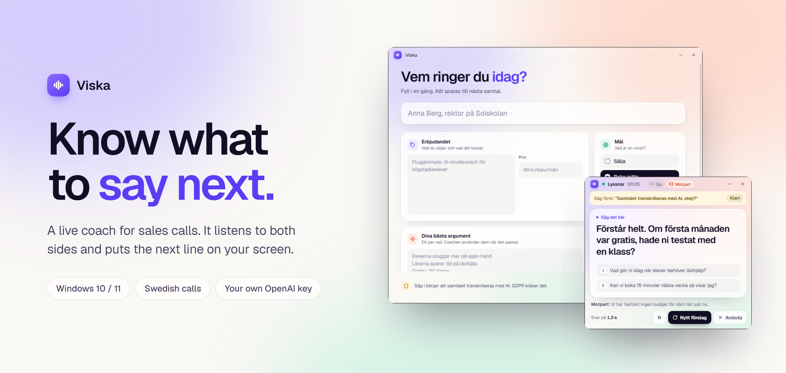
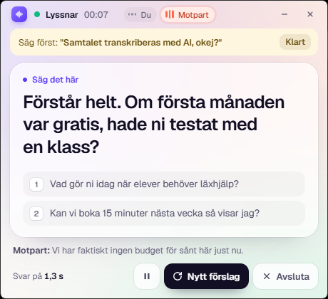
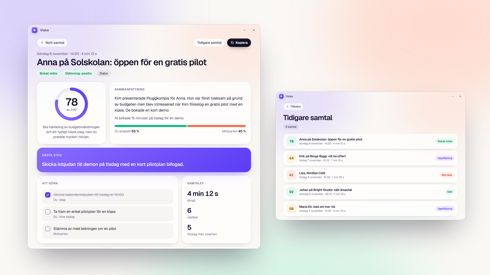
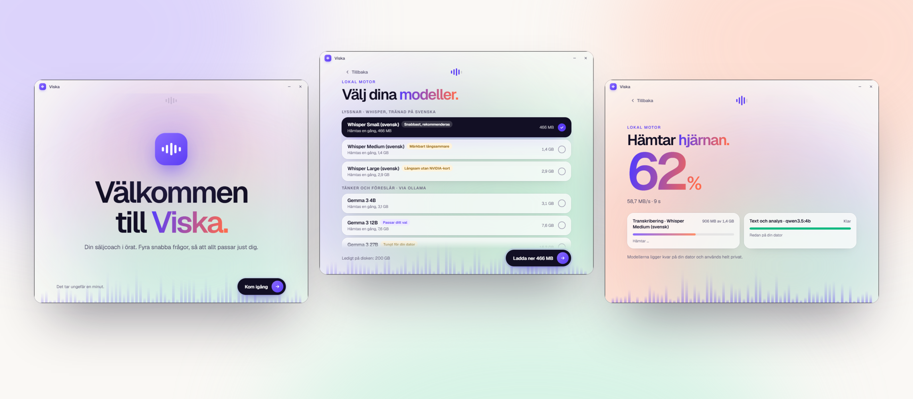
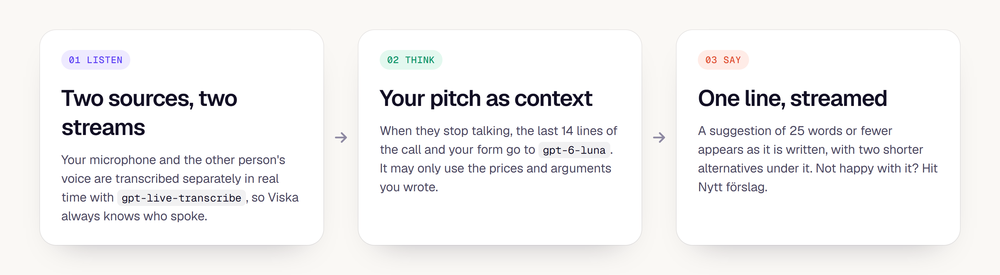

<p align="center">
  
</p>

<p align="center">
  <a href="https://github.com/welovevyxzl/viska/releases/latest/download/Viska.exe"></a>
</p>

<p align="center">
  <a href="#during-the-call">During the call</a> &nbsp;·&nbsp;
  <a href="#after-the-call">After the call</a> &nbsp;·&nbsp;
  <a href="#first-run">First run</a> &nbsp;·&nbsp;
  <a href="#cloud-or-local">Cloud or local</a> &nbsp;·&nbsp;
  <a href="#privacy">Privacy</a> &nbsp;·&nbsp;
  <a href="#build-from-source">Build from source</a>
</p>

<br>

Viska is a Windows app for people who sell over the phone. It listens to your call, shows you what to say next while you are still talking, and writes up the whole call when you hang up: a summary, what you need to do, and how you did.

It is built for calls in Swedish. It can run on OpenAI's cloud, or entirely on your own PC.

<br>

## During the call

<table>
<tr>
<td width="55%" valign="middle">

A small window sits on top of your call. The other person says "we have no budget for this", and a moment later you see a line you can say back, plus two alternatives.

Before you start, you fill in who you are calling, who you are, what you sell, the price, your best arguments and the objections you expect. Viska only uses what you wrote. It will not invent prices or promises, and if someone asks who is calling, it answers with your name and company.

Press **N** for a new suggestion, **P** to pause, **1** or **2** to swap in an alternative.

</td>
<td width="45%" align="center" valign="middle">

</td>
</tr>
</table>

<br>

## After the call

When you press Avsluta, Viska reads the whole call and gives you a debrief.

<p align="center">
  
</p>

- A **score** from 0 to 100, the outcome (sold, meeting booked, follow-up, no), the mood, and how much each of you talked.
- The **next step** that matters most, and a list of **to-dos** for you and for them. You can tick them off.
- What **they said** and what **you said**, what went well, and what to do better next time.
- Every **objection**, how you handled it, and a better reply for next time.
- A **follow-up email**, ready to copy.
- The **full transcript** with timestamps.

Every call is saved, so you can open old ones from **Tidigare samtal** on the start screen.

<br>

## First run

The first time you open Viska it asks a few questions: your name, what you want out of it, how good it should be, and where it should think. If you already use Viska, it skips this. You can run it again from **Inställningar**.

<p align="center">
  
</p>

<br>

## Cloud or local

| | OpenAI cloud | On your PC |
|---|---|---|
| Listening | `gpt-transcribe` | Whisper, trained on Swedish (KBLab) |
| Thinking and the debrief | `gpt-6-luna` and `gpt-6.1-terra` | Any model in [Ollama](https://ollama.com), such as Gemma 3 |
| You need | Your own OpenAI API key | A decent PC, Ollama, and a one-time download |
| Cost | You pay OpenAI per use | Free once the models are downloaded |
| Where your calls go | Audio and text are sent to OpenAI | Nothing leaves your PC |

Local mode takes some honest trade-offs.

- **Speed.** Measured on a 12-core CPU, Whisper Small writes out 9 seconds of speech in about 2 seconds. Medium is around three times slower and Large around six, so Viska recommends Small unless you have an NVIDIA graphics card that Whisper can actually use. The first-run test shows how long it takes on your PC.
- **Graphics card.** Whisper only uses an NVIDIA card when the CUDA 12 libraries (`cublas64_12.dll`) are installed. Without them it quietly falls back to the processor.
- **The text model.** It runs in Ollama. If other programs fill your graphics memory, the first suggestion can be slow. After the model is loaded, the first word usually comes in well under a second.
- **Debrief quality.** Small local models follow the debrief format less reliably than the cloud. Viska corrects what it can, and you can pick a larger model in the setup.

<br>

## How it works

<p align="center">
  
</p>

Each audio source is cut into turns by a simple voice detector that tracks the background noise, so quiet calls still register. When someone stops talking, the whole turn is transcribed in one piece, not as a live stream, so the model hears the full sentence and gets it right more often. Names and product words from your form go along as spelling hints.

<br>

## Install

1. Download [Viska.exe](https://github.com/welovevyxzl/viska/releases/latest/download/Viska.exe). There is no installer, and the file is about 100 MB because Whisper is built in.
2. Run it and answer the first-run questions.
3. Fill in the form, choose a mode and press **Starta samtal**.

Windows SmartScreen will probably warn about an unknown publisher, because the exe is not code-signed. Choose More info, then Run anyway.

Viska runs on **Windows 10 and 11**. The engines (Whisper and Ollama) also exist for Mac, but Viska's audio capture and window code are Windows-only for now, so there is no Mac version yet.

### Two modes

| | Computer | Phone on speaker |
|---|---|---|
| For | Calls on your PC: Teams, Meet, WhatsApp | A phone placed next to the PC |
| Their voice | Captured from the PC's audio output | Picked up by the microphone |
| Who is talking | Detected automatically | Hold the button (or Space) while they talk |

Computer mode gives the best transcription, because their voice arrives digitally. In phone mode it has to travel through the speaker and the air.

<br>

## Privacy

- **On your PC:** your settings and API key, and every call's transcript and debrief, in `%APPDATA%\Viska`. Downloaded Whisper models are in `%APPDATA%\Viska\models`. Viska does not keep audio.
- **Cloud mode:** the audio of each turn is sent to OpenAI for transcription, and the text of the conversation for the coach and the debrief, using your own key.
- **Local mode:** nothing is sent anywhere. The only internet use is the one-time model download.
- **Tell the person you are calling.** Say at the start that the call is transcribed with AI and saved. GDPR requires it, and Viska reminds you in the live view.

<br>

## Build from source

Needs Windows and a recent Python 3. The release exe was built with 3.14.

```bash
python -m venv .venv
.venv\Scripts\python -m pip install -r requirements.txt
copy .env.example .env
```

Put your key in `.env` (git-ignored) if you want the cloud mode, then run:

```bash
.venv\Scripts\python samtalscoach.py
```

To build the exe:

```bash
.venv\Scripts\python -m PyInstaller --noconfirm --onefile --windowed --name Viska --add-data "ui;ui" samtalscoach.py
```

The result is `dist\Viska.exe`.

<details>
<summary>Files and troubleshooting</summary>

<br>

- `samtalscoach.py` holds audio capture, the coach and the debrief. `engines.py` holds the local parts: model download, Whisper and Ollama. `ui/index.html` is the whole interface, and `ui/onboard.js` and `ui/onboard.css` are the first-run setup.
- The key is read from the `OPENAI_API_KEY` environment variable, then a `.env` file next to the exe, then the saved settings.
- Settings are in `%APPDATA%\Viska\config.json`, saved calls in `%APPDATA%\Viska\calls`, and a debug log in `%APPDATA%\Viska\viska.log`. The log shows how long each transcription took.
- If the mic will not open, it is probably muted (Fn key or Windows sound settings). Unmute, press Avsluta, then Starta.
- If you hear nothing from the other person in Computer mode, check that the call audio plays through the output device chosen in setup.
- If a model download stops, run the setup again from Inställningar. Downloads continue where they left off.
- If the debrief shows an error, it says what went wrong, and there is a button to try again. The transcript is saved either way.

</details>
