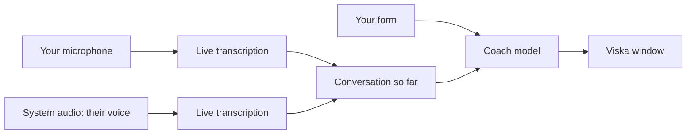

# Viska

A Windows app that listens to your sales call and shows what to say next. It is made for calls in Swedish.

**[Download Viska.exe](https://github.com/welovevyxzl/viska/releases/latest/download/Viska.exe)** (Windows 10/11, no installer)

<p align="center">
  
</p>

## What it does

The other person says "we don't have the budget for this right now". A second or two later Viska shows a line you can say out loud, plus two alternatives:

> Förstår helt. Om första månaden var gratis, hade ni testat med en klass?
> 1. Vad gör ni idag när elever behöver läxhjälp?
> 2. Kan vi boka 15 minuter nästa vecka så visar jag?

It runs in a small window that stays on top of your call. You fill in who you are calling, what you sell, the price, your arguments and the objections you expect. Viska only uses what you wrote and does not make up prices or promises.

<p align="center">
  
</p>

## Getting started

1. Download `Viska.exe` from the [latest release](https://github.com/welovevyxzl/viska/releases/latest).
2. Run it and paste in your OpenAI API key. It is stored on your PC only.
3. Fill in the form, pick a mode and press Starta samtal.

Windows SmartScreen will probably warn about an unknown publisher, because the exe is not code-signed. Click More info, then Run anyway.

You use your own OpenAI key and pay OpenAI for the usage. Tell the person you are calling that the call is transcribed with AI; GDPR requires it.

## Modes

| | Computer | Phone on speaker |
|---|---|---|
| When | The call is on your PC (Teams, Meet, WhatsApp) | You call from a phone next to the PC |
| Their voice | Captured from the PC's audio output | Picked up by the microphone |
| Your voice | Microphone | Microphone |
| Who is talking | Detected automatically | Hold the button (or Space) while they talk |

## How it works



- Each audio source has its own connection to OpenAI's Realtime API (`gpt-live-transcribe`). A simple voice detector follows the background noise and ends a turn after about half a second of silence.
- Names and product words from your form are sent as hints so they are spelled correctly. Text in other alphabets, which the transcriber sometimes hallucinates, is dropped.
- When the other person finishes, the last 14 lines of the conversation and your form go to `gpt-6-luna`. It is told to answer in spoken Swedish in at most 25 words.
- The answer is streamed into the window as it is written.

## Build from source

Needs Windows and a recent Python 3. The release exe was built with 3.14.

```bash
python -m venv .venv
.venv\Scripts\python -m pip install -r requirements.txt
copy .env.example .env
```

Put your key in `.env` (git-ignored), then:

```bash
.venv\Scripts\python samtalscoach.py
```

To build the exe:

```bash
.venv\Scripts\python -m PyInstaller --noconfirm --onefile --windowed --name Viska --add-data "ui;ui" samtalscoach.py
```

The result is `dist\Viska.exe`.

## Files

- `samtalscoach.py`: audio capture, transcription, the coach and the window logic
- `ui/index.html`: the interface, shown with pywebview (WebView2)
- `%APPDATA%\Viska\config.json`: your saved form and settings
- `%APPDATA%\Viska\viska.log`: log for debugging audio problems

The API key is read from the `OPENAI_API_KEY` environment variable first, then a `.env` file next to the exe, then the saved config.

## Troubleshooting

- "Mikrofonen går inte att öppna": the mic is muted (Fn key or Windows sound settings). Unmute, press Avsluta, then Starta.
- Nothing from the other person in Computer mode: check that the call audio plays through the output device selected in setup.
- Names are misspelled: add them to the form.
- Anything else: read `%APPDATA%\Viska\viska.log`.
